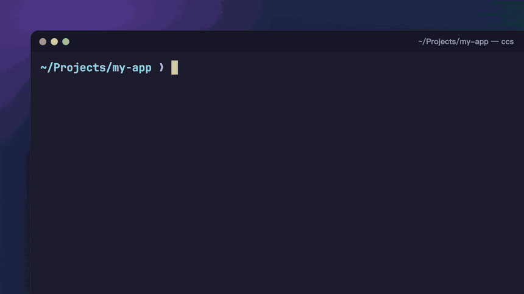

# ccs

跨專案瀏覽 [Claude Code](https://claude.com/claude-code) 的 session，選一個就能複製 resume 指令。

Claude Code 依「開啟時的目錄」分開存放 session，`claude --resume` 只列得出目前目錄的 session。專案和 worktree 一多，常常想不起某段對話是在哪個目錄開的。`ccs` 把所有專案的 session 集中在一個 TUI 裡：用方向鍵挑選、打字搜尋，右邊預覽對話內容。按 Enter 就會把 `cd <目錄> && claude -r <session id>` 複製到剪貼簿。

[](demo/ccs-demo-web.mp4)

點上面的動畫可以下載 1080p 的 MP4 版本。影片裡的 session 全部是虛構資料，錄製方式在 [`demo/`](demo/)。

## 功能

- 列出 `~/.claude/projects/` 底下**所有專案**的 session，最近有活動的排在最前面
- 打字即時搜尋，標題、專案路徑、分支、prompt 都搜得到；空白分隔多個關鍵字，中文也可以
- 右側預覽整段對話，你的 prompt 和 AI 的回覆交錯排列。打開時停在最近 3 輪，往上捲可以一路看到第一輪
- AI 回覆裡的 markdown 會渲染出來：粗體、標題、`程式碼`、清單、表格（欄位對齊，儲存格內會換行）
- Enter 複製 resume 指令；Ctrl-O 直接在該目錄開啟 session
- 目錄已經不存在的 session（例如 worktree 被刪掉）會用紅色 ✗ 標出來
- 只有一個 Python 檔，不用安裝任何套件

## 安裝

需要 Python 3.8 以上。目前只在 macOS 上測試過。複製到剪貼簿用的是 `pbcopy`，沒有 `pbcopy` 的環境會改成直接印出指令。

```sh
git clone https://github.com/FuYaoDe/ccs.git ~/ccs   # 放在哪裡都可以
ln -s ~/ccs/ccs ~/.local/bin/ccs                     # 連到任何一個在 PATH 裡的目錄
```

也可以只下載那一個檔案：

```sh
curl -fsSL https://raw.githubusercontent.com/FuYaoDe/ccs/main/ccs -o ~/.local/bin/ccs
chmod +x ~/.local/bin/ccs
```

## 使用

```sh
ccs                # 開啟 TUI
ccs 登入 api       # 帶著搜尋關鍵字開啟
ccs --print        # 選好後只把 resume 指令印到 stdout（不複製），方便用在腳本裡
ccs | grep 登入    # 輸出不是終端機時，改成純文字列出所有 session
```

在 shell 設定檔裡加上這個函式，選完就會直接切到該目錄並 resume：

```sh
cr() { local cmd; cmd="$(ccs --print "$@")" && eval "$cmd"; }
```

### 按鍵

| 按鍵 | 作用 |
|---|---|
| ↑ ↓（或 Ctrl-P / Ctrl-N） | 選擇 session |
| Home / End | 跳到第一筆 / 最後一筆 |
| 直接打字 | 搜尋 |
| Backspace / Ctrl-W / Ctrl-U | 刪一個字 / 刪一個詞 / 清空搜尋 |
| Shift-↑ / Shift-↓、滑鼠滾輪 | 捲動預覽（滾輪在列表上則是換選擇） |
| PgUp / PgDn、Ctrl-B / Ctrl-F | 預覽整頁翻 |
| 滑鼠點一下 | 選擇 session |
| Enter | 複製 resume 指令並離開 |
| Ctrl-O | 直接在該目錄開啟 session |
| Ctrl-L | 重畫整個畫面 |
| Esc / Ctrl-C | 離開 |

TUI 開啟了滑鼠功能，要反白選取文字時需要按住修飾鍵再拖曳：Ghostty 和多數 Linux 終端機是 Shift，iTerm2 是 Option。

## 設定

修改檔案開頭的常數：

| 常數 | 預設 | 說明 |
|---|---|---|
| `PROMPT_MAX` | 100 | 預覽中每則 prompt 超過這個字數就截斷 |
| `REPLY_MAX` | 300 | 每段 AI 回覆超過這個字數就截斷，markdown 符號不算在內 |
| `TURNS_SHOWN` | 3 | 預覽打開時停在最近幾輪 |
| `SCROLL_STEP` | 3 | Shift-↑↓ 或滾輪一次捲幾行 |

## 運作方式

- 資料來源是 Claude Code 自己存的對話紀錄 `~/.claude/projects/*/*.jsonl`。不用另外記錄，也不會修改這些檔案。
- 列表用的摘要（目錄、分支、標題、最後一則 prompt）快取在 `~/.cache/ccs/index.json`，只有變動過的檔案才會重新解析。
- 標題優先用你以 `/rename` 或 `claude -n` 取的名字，其次是 Claude Code 自動產生的標題，都沒有時才用第一則 prompt。
- 「最後活動時間」取自紀錄裡最後一個時間戳，不用檔案修改時間。原因是 Claude Code 會在舊 session 的檔尾補寫 metadata，讓修改時間失準。
- resume 必須在 session 開始時的目錄執行，所以指令裡的 `cd` 用的是 session 的第一個工作目錄。
- 預覽裡的 AI 回覆是那一輪的最後一段文字，通常就是結論。工具呼叫、思考過程和背景任務通知都不會顯示。

## 小提醒：Claude Code 預設只保留 30 天

Claude Code 預設會刪除 30 天以前的對話紀錄，被刪掉的 session 就無法 resume。想保留久一點，可以在 `~/.claude/settings.json` 加上：

```json
{
  "cleanupPeriodDays": 365
}
```
